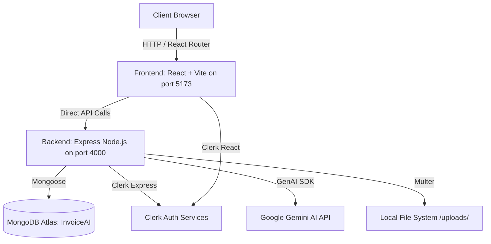
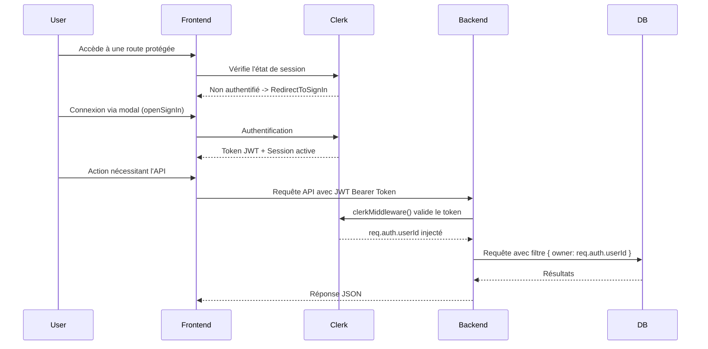

# InvoiceAI - Documentation Technique

Cette documentation décrit l'architecture, les technologies et les flux fonctionnels du projet **InvoiceAI**, une application de création et de gestion de factures assistée par intelligence artificielle.

---

## 1. Architecture du Système

L'application repose sur une architecture client-serveur classique, avec un frontend React communiquant directement avec une API Express (sans proxy Vite).



### Points Clés de l'Architecture
- **Frontend** : React/Vite sur le port `5173`.
- **Backend** : Express/Node.js sur le port `4000`.
- **Base de données** : MongoDB Atlas (nom de la base : `InvoiceAI`), connexion configurée dans `config/db.js`.
- **Authentification** : Gestion par Clerk (middleware global sur le backend, fournisseurs et composants UI sur le frontend).
- **Intelligence Artificielle** : API Google Gemini (modèles de fallback : `gemini-2.5-flash` -> `gemini-2.0-flash` -> `gemini-2.0`).
- **Fichiers Statiques** : Gérés par Multer dans `backend/uploads/` et servis via la route `/uploads`.

---

## 2. Versions Techniques Exactes

### Frontend

| Technologie | Version | Détails |
| --- | --- | --- |
| React | 19.2.8 | Bibliothèque UI |
| Vite | 8.2.0 | Bundler |
| Tailwind CSS | 4.3.3 | Via plugin `@tailwindcss/vite` et approche `@import "tailwindcss"` |
| React Router DOM | 7.18.2 | Routage client |
| Clerk React | ^5.61.9 / ^6.12.10 | Authentification côté client |
| OxLint | - | Linter basé sur Rust |
| Google Fonts | Outfit | Poids de 300 à 800 |

### Backend

| Technologie | Version | Détails |
| --- | --- | --- |
| Express | 5.2.1 | Framework Node.js (ES modules) |
| Mongoose | 9.9.1 | ODM MongoDB |
| Clerk Express | 2.1.49 | Middleware d'authentification |
| Google GenAI SDK | 2.16.0 | Intégration Gemini AI |
| Multer | 2.2.0 | Gestion des uploads multipart/form-data |
| jsonwebtoken | 9.0.3 | Gestion des JWT |
| bcryptjs | 3.0.3 | Hashage (si nécessaire) |
| validator | 13.15.35 | Validation de données |
| body-parser | 2.3.0 | Parsing des requêtes |
| dotenv | 17.4.2 | Variables d'environnement |
| cors | 2.8.6 | Cross-Origin Resource Sharing |
| nodemon | 3.1.14 | Hot-reloading en développement |

---

## 3. Modèles de Base de Données

### Modèle `Invoice` (invoiceModel.js)

Gère les données des factures générées ou saisies manuellement.

**ItemSchema (Sous-document embarqué) :**
- `id` (String)
- `description` (String)
- `qty` (Number, default: 1)
- `unitPrice` (Number, default: 0)

**Champs Principaux :**

| Champ | Type | Description |
| --- | --- | --- |
| `owner` | String | ID Utilisateur Clerk (Indexé, Requis) |
| `invoiceNumber` | String | Numéro auto-généré (Format: `INV-******-******`) (Indexé, Requis) |
| `issueDate`, `dueDate` | Date | Dates d'émission et d'échéance |
| `fromBusinessName`, `fromEmail`, `fromAddress`, `fromPhone`, `fromIce` | String | Informations de l'émetteur (ICE = Identifiant Fiscal Marocain) |
| `client` | Object | `{ name, email, address, phone }` |
| `items` | [ItemSchema] | Liste des articles/services facturés |
| `currency` | String | Devise, default: `'MAD'` |
| `status` | Enum | `'draft'`, `'unpaid'`, `'paid'`, `'overdue'` (Default: `'draft'`) |
| `logoDataUrl`, `stampDataUrl`, `signatureDataUrl` | String | Images encodées en base64 associées au document |
| `signatureName`, `signatureTitle` | String | Informations textuelles de signature |
| `taxPercent` | Number | Pourcentage de taxe (Default: 20) |
| `subtotal`, `tax`, `total` | Number | Montants calculés automatiquement |

### Modèle `BusinessProfile` (businessProfileModel.js)

Stocke les informations de l'entreprise de l'utilisateur.

| Champ | Type | Description |
| --- | --- | --- |
| `owner` | String | ID Utilisateur Clerk (Indexé, Requis) |
| `businessName` | String | Nom de l'entreprise (Requis) |
| `email`, `address`, `phone`, `ice` | String | Coordonnées et Identifiant Fiscal (ICE) |
| `logoUrl`, `stampUrl`, `signatureUrl` | String | Chemins locaux des fichiers uploadés (`/uploads/...`) |
| `signatureOwnerName`, `signatureOwnerTitle` | String | Détails du signataire |
| `defaultTaxPercent` | Number | Taux de taxe par défaut (Default: 20) |

*(Note : Les deux modèles incluent automatiquement les `timestamps` Mongoose).*

---

## 4. Flux d'Authentification

La sécurité et la gestion des utilisateurs s'appuient intégralement sur Clerk.



### Étapes :
1. Le Frontend englobe l'application avec `<ClerkProvider>` utilisant `VITE_CLERK_PUBLISHABLE_KEY`.
2. Les `ProtectedRoute` utilisent les composants Clerk `<SignedIn>` et `<SignedOut>` (avec `<RedirectToSignIn />`).
3. La `Navbar` déclenche les modals via `openSignIn()` et `openSignUp()`.
4. Le Backend implémente `clerkMiddleware()` de façon globale pour analyser les tokens.
5. Les routes privées du backend nécessitent `requireAuth()` depuis `@clerk/express`.
6. L'identité de l'utilisateur est accessible via `req.auth.userId` (qui correspond au champ `owner` en base).

---

## 5. Génération de Factures par IA

L'intégration de Gemini permet de générer des factures à partir de descriptions en langage naturel.

1. L'utilisateur ouvre le composant `AiInvoiceModal` et saisit un prompt naturel (ex: *"Facture pour la création d'un site web client Acme Corp 5000 MAD"*).
2. Le frontend effectue un `POST` vers `/api/ai/generate` contenant le payload `{ prompt }`.
3. Le backend tente d'appeler les modèles Gemini dans l'ordre suivant :
   - `gemini-2.5-flash`
   - `gemini-2.0-flash`
   - `gemini-2.0`
4. Le *System Prompt* ordonne à Gemini de renvoyer un JSON structuré comprenant le client, les items, les dates et les montants.
5. La réponse JSON est parsée par le backend, renvoyée au frontend, et auto-remplit le formulaire de création de facture.

---

## 6. Endpoints API

Toutes les routes API nécessitent une authentification valide via Clerk.

### Invoices (`/api/invoice`)

| Méthode | Route | Description |
| --- | --- | --- |
| `GET` | `/` | Liste les factures. Supporte les requêtes: `?status=` & `?search=` (cherche dans email, nom client, numéro de facture). |
| `GET` | `/:id` | Récupère une facture spécifique (par `ObjectId` ou `invoiceNumber`). |
| `POST` | `/` | Crée une facture (auto-génère `INV-******-******`, calcule subtotal/tax/total). |
| `PUT` | `/:id` | Met à jour une facture par `ObjectId` ou `invoiceNumber`. |
| `DELETE` | `/:id` | Supprime une facture. |

### Business Profile (`/api/businessProfile`)

| Méthode | Route | Description |
| --- | --- | --- |
| `GET` | `/me` | Récupère le profil de l'utilisateur connecté (`req.auth.userId`). |
| `POST` | `/` | Crée un profil. Supporte l'upload multipart pour : `logoName`, `stampName`, `signatureNameMeta`. |
| `PUT` | `/:id` | Met à jour un profil (inclus les nouveaux uploads de fichiers). |

### AI (`/api/ai`)

| Méthode | Route | Description |
| --- | --- | --- |
| `POST` | `/generate` | Traite le prompt textuel et renvoie les données JSON de la facture générée par l'IA. |

---

## 7. Routage Frontend

Le routage est géré par React Router DOM (`v7.x`).

- `/` : Accueil (Public Landing Page)
- `/app` : AppShell (Layout protégé, nécessite `<SignedIn>`)
  - `/app/dashboard` : Tableau de bord (Statistiques)
  - `/app/invoices` : Liste des factures (Recherche, filtres, tri, pagination)
  - `/app/invoices/new` ou `/app/create-invoice` : Création de facture (`CreateInvoice`)
  - `/app/invoices/:id` ou `/app/invoices/:id/preview` : Aperçu de la facture (`InvoicePreview`)
  - `/app/invoices/:id/edit` : Mode édition de facture (`CreateInvoice`)
  - `/app/business` : Gestion du profil d'entreprise (`BusinessProfile`)
- `*` : Page 404 (Not Found)

---

## 8. Architecture des Styles

L'architecture CSS repose fortement sur Tailwind v4 et une centralisation JavaScript.

- **Centralisation** : Toutes les classes Tailwind sont regroupées dans `src/assets/dummyStyles.js` sous forme d'objets JS (permettant une réutilisation sémantique).
- **Constantes Exportées** :
  - `appShellStyles`
  - `dashboardStyles`
  - `kpiCardStyles`
  - `statusBadgeStyles`
  - `invoicesPageStyles`
  - `createInvoiceStyles`
  - `businessProfileStyles`
- **Global CSS (`src/index.css`)** :
  - Utilise l'approche v4 `@import "tailwindcss"`.
  - Définit les styles spécifiques pour l'impression (`@media print`).
  - Déclare les animations personnalisées : `blob`, `float-slow`, `float-medium`, `pulse-slow`.

### Exemple de pattern `dummyStyles.js` :
```javascript
export const statusBadgeStyles = {
  paid: "bg-green-100 text-green-800",
  unpaid: "bg-red-100 text-red-800",
  draft: "bg-gray-100 text-gray-800",
  overdue: "bg-orange-100 text-orange-800"
};
```

---

## 9. Système d'Upload de Fichiers

La gestion des fichiers (images) s'effectue via Multer côté serveur.

- **Stockage** : Multer utilise `diskStorage` pour sauvegarder les fichiers dans le dossier `backend/uploads/`.
- **Format de nommage** : `business-<timestamp>-<random>.<extension>` (pour éviter les conflits).
- **Service Statique** : Express sert ces fichiers de manière statique via la route `/uploads`.
- **Typologie d'images** : Concerne principalement les éléments du `BusinessProfile` : `logo`, `stamp` (cachet), `signature`.
- **Images de la Facture** : Contrairement au profil, les images attachées à un document `Invoice` spécifique sont converties et stockées directement en tant que Data URLs (`base64`) dans la base de données.

---

## 10. Devises et Taxes

L'application est optimisée pour un contexte marocain/international.

- **Devises supportées** : MAD (Dirham Marocain - par défaut) et EUR (Euro).
- **Taxe (TVA)** : Taux par défaut à **20%**.
- **ICE** : Champ d'Identification Fiscale marocaine inclus dans le Business Profile.
- **Tableau de Bord** : Les KPIs et widgets financiers du dashboard convertissent et agrègent tous les montants en **MAD** pour une vue unifiée.
